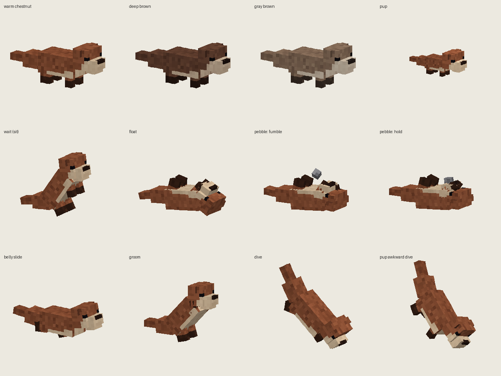

# Otter & the Pebble — mod Forge 1.20.1

Uma pequena companheira de rio para o Minecraft, feita a partir do GDD **"Otter & the pebble" (HUUDA, working draft 04, out/2026)**.
Um filhote escolhe a sua oferta; o vínculo continua enquanto ele cresce.



| | |
|---|---|
| Minecraft | 1.20.1 |
| Loader | Forge 47.4.0 ou mais novo (47.x) |
| Dependência | **GeckoLib 4.8.2 ou mais novo para Forge 1.20.1** (precisa estar instalado na pasta `mods`) |
| Mod ID | `otterpebble` |
| Arquivo gerado | `build/libs/otterpebble-1.20.1-1.0.0.jar` |

---

## Como gerar o .jar pelo GitHub

1. Crie um repositório (pode ser privado) e envie **todo** o conteúdo desta pasta, incluindo as pastas ocultas `.github` e `gradle`.
   O jeito mais seguro é pelo terminal:
   ```bash
   cd otter-pebble
   git init
   git add .
   git commit -m "Otter & the Pebble 1.0.0"
   git branch -M main
   git remote add origin https://github.com/SEU_USUARIO/SEU_REPO.git
   git push -u origin main
   ```
   Se for pelo site (Add file → Upload files), confira se a pasta `.github/workflows` subiu: alguns sistemas escondem pastas que começam com ponto.
2. Abra a aba **Actions** do repositório. O workflow **Build mod jar** roda sozinho a cada push (ou clique em *Run workflow*).
   A primeira execução leva alguns minutos, porque o Gradle baixa o Minecraft e o Forge.
3. Quando terminar, entre na execução e baixe o artefato **otterpebble-jar**. Dentro do zip está o `.jar` do mod.
4. Para gerar uma *Release* com o `.jar` anexado, crie uma tag começando com `v`:
   ```bash
   git tag v1.0.0
   git push origin v1.0.0
   ```

Para compilar no seu computador: tenha o JDK 17 e rode `./gradlew build` (Windows: `gradlew.bat build`).
`./gradlew runClient` abre um Minecraft de teste com o mod.

---

## Como jogar

**Onde encontrar:** em rios temperados (bioma `minecraft:river`), em famílias de um adulto com filhotes. No criativo, use o **Ovo Gerador de Lontra** (aba de ovos geradores). Usar o ovo em cima de uma lontra cria um filhote.

**Vínculo (Approach → Inspect → Accept).** Só um filhote sem dono pode criar vínculo.
1. Segure um peixe cru (bacalhau, salmão ou peixe tropical) e fique a mais de 2 e até 8 blocos do filhote, parado ou andando devagar, sem correr. Correr perto assusta o filhote.
2. Depois de uns 2 segundos de calma, o filhote fica **curioso**: olha para você e inclina a cabeça.
3. Clique com o botão direito no filhote com o peixe. Ele **inspeciona** a oferta (cheira) por uns 2,5 s.
4. Ele **aceita**: come o peixe, solta corações e passa a ser seu.
   - Cedo demais, correndo, se afastando, trocando de item ou se ele se machucar: nada é consumido (*"You keep the fish"*).
   - Só um dono por lontra; spam de cliques ou dois jogadores ao mesmo tempo nunca gastam itens nem trocam o dono.

**Ordens (Follow / Wait).** Clique com o botão direito na sua lontra **com a mão vazia** para alternar entre **Seguir** e **Esperar**.
No Esperar ela fica num ponto seguro (senta em terra ou boia na água) e não resgata nem viaja. Se o lugar ficar perigoso, ela procura outro ponto seguro perto. Se o dono sai do jogo, a ordem continua a mesma.

**Cumprimento (chirp & answer).** Olhe para a sua lontra **com a mão principal vazia** por ~1 s: ela vira a cabeça, faz um chirp e aparece uma nota musical (o sinal funciona sem som). A ordem não muda. Para repetir, desvie o olhar e espere a recarga.

**Resgate da ferramenta.** Se você soltar uma ferramenta (tecla Q) e ela cair na água, a lontra em modo Seguir mergulha, pega o item com a boca e devolve na sua mão:
- mesmo item, mesma quantidade, durabilidade, encantamentos e nome; o tempo de vida restante do item é preservado (não reinicia);
- só itens soltos pelo **dono**, nos últimos 60 s, em água segura (sem lava nem monstros por perto);
- inventário cheio: o item fica no chão, aos seus pés, e só você pode pegá-lo;
- se ela morrer, receber Esperar ou não conseguir entregar, o item é largado uma única vez (nunca duplica).

**Cuidado.** Dar peixe cru à **sua** lontra (quando está ferida ou ainda é filhote) cura 3 pontos de vida e acelera o crescimento. O dono e o seixo continuam depois que o filhote cresce.

**Comportamentos de personalidade (aprovados no GDD).**
- **Deslizar de barriga**: num barranco livre com pouso seguro, ela escorrega até a água.
- **Se limpar depois de nadar**: sacode o corpo e esfrega o rosto com as patas. Se o dono se afastar, ela interrompe para seguir.
- **Aprender olhando**: quando um adulto mergulha do barranco, os filhotes perto assistem e depois tentam um mergulho menor e desajeitado, por um caminho seguro próprio. Um filhote em Esperar só assiste.
- **O seixo escolhido**: lontras com vínculo boiam de costas e brincam com o seixo (passa, deixa cair, pega, segura). É só um adereço visual, não vira item.
- **Boiar de mãos dadas** (pedido no GDD): duas lontras adultas na água boiam juntas segurando uma pata cada, com deriva curta e limitada. Qualquer ordem desfaz o par.

---

## Como o GDD virou código

| Slide do PDF | No mod |
|---|---|
| 02 / 13 — Uma silhueta, duas idades; 3 paletas | Um único modelo GeckoLib. Filhote = 55% do tamanho e cabeça 35% maior. Paletas *warm chestnut*, *deep brown* e *gray-brown* só visuais (escolhidas por família) |
| 04 / 05 — O filhote escolhe a oferta | Estados Unbonded → Curious → Inspecting → Bonded; oferta = peixe (decisão da equipe: "pode ser peixe") |
| 06 — Follow, Wait e cumprimento | Mão vazia + usar alterna a ordem; olhar de mão vazia faz o chirp |
| 07 / 08 — A ferramenta volta | Notice → Claim & dive → Carry → Deliver, com claim exclusivo e item idêntico |
| 09 — Chirp, deslizar, se limpar | Animações `chirp`, `slide`, `groom` |
| 10 — Aprender olhando | `dive` do adulto + `awkward_dive` do filhote |
| 11 — O seixo escolhido | `pebble_play` (pass, fumble, catch) + `pebble_hold` |
| 12 — Um momento tranquilo juntos | `float_pair_left_paw` / `float_pair_right_paw`, trava mútua de parceiro |
| 14 — Estados de comportamento | Relação, ordem e ação atual sincronizadas para o cliente |
| 18 — Apêndice A (integridade) | Commit do vínculo e coleta do item no mesmo tick; registro de carga salvo; liquidação única |
| 19 — Apêndice B (prioridades e save) | Prioridade dos goals segue a lista 01–08; salva dono, idade, seixo, ordem, âncora, nome, vida, recargas e carga pendente |
| 20 — Apêndice C (testes de aceitação) | Usado como checklist na revisão do código. O teste em jogo (single-player + servidor com 2 clientes) ainda precisa ser feito pela equipe |
| 21 — Apêndice D (opções futuras) | Pesca extra e splash contra Afogado já implementados, **desligados** na config até aprovação |

### Decisões da equipe (slide 17)

| Decisão | Escolha neste mod |
|---|---|
| 01 Rota técnica | Java Edition, Forge 1.20.1, GeckoLib 4 e modelo do Blockbench |
| 02 O seixo | A oferta do vínculo é **peixe cru** (bacalhau, salmão ou peixe tropical). O seixo virou só adereço visual de quem tem vínculo. No criativo, o peixe não é gasto |
| 03 Resgate confiável | A origem do item vem do evento de soltar item (tecla Q) do próprio dono; o item é copiado inteiro, com todos os dados |
| 04 Mundo e sensação | Bioma `minecraft:river`, famílias de 2 a 3; controles de mão vazia; peixe para cuidar; todos os números na config |

A captura de 28 s do slide 16 é um vídeo a ser gravado no jogo, então não faz parte do código.

---

## Configuração

Arquivo `config/otterpebble-common.toml` (criado na primeira execução). Principais opções:

| Seção | Opção | Padrão |
|---|---|---|
| general | `palette` (`RANDOM`, `WARM_CHESTNUT`, `DEEP_BROWN`, `GRAY_BROWN`) | `RANDOM` |
| bond | `calmTicksBeforeCurious`, `inspectTicks`, `curiousRange` | 40, 50, 8 |
| orders | `followStartDistance`, `teleportDistance` (0 desliga) | 6, 14 |
| rescue | `enabled`, `searchRange`, `recentDropSeconds`, `maxCarrySeconds` | true, 16, 60, 120 |
| greeting | `gazeTicks`, `chirpCooldownSeconds` | 20, 10 |
| behaviours | `bellySlide`, `postSwimGroom`, `learningByWatching`, `pebblePlay`, `pairedFloat` | true |
| future_options | `fishingSupport` (10 blocos / 25% / 90 s) e `drownedEscapeSplash` (60 s) | **false** |

Listas editáveis por datapack (tags de item):
- `otterpebble:bond_offerings` — o que o filhote aceita no vínculo;
- `otterpebble:care_food` — o que cura;
- `otterpebble:rescuable_tools` — o que a lontra resgata (ferramentas, armas, tridente, tesoura, vara de pesca etc.).

Biomas de spawn: `data/otterpebble/forge/biome_modifier/otter_spawns.json`.

---

## Modelo, texturas e animações (GeckoLib + Blockbench)

- `blockbench/otter.bbmodel` — projeto do Blockbench no formato **GeckoLib Animated Model**, com as 3 texturas e as 22 animações.
  Para abrir: instale o plugin **GeckoLib Models & Animations** no Blockbench (File → Plugins).
  Depois de editar, exporte com *File → Export → GeckoLib Model / Animations* para as pastas abaixo.
- `src/main/resources/assets/otterpebble/geo/entity/otter.geo.json` — geometria usada no jogo.
- `src/main/resources/assets/otterpebble/animations/entity/otter.animation.json` — animações usadas no jogo.
- `src/main/resources/assets/otterpebble/textures/entity/otter/*.png` — paletas.

Ossos: `root`, `body`, `head` (`jaw`, `ear_left`, `ear_right`, `item_mouth`), `leg_front_left/right`, `leg_hind_left/right`, `tail` (`tail_tip`) e `pebble`.
Todo rig tem duas patas dianteiras, duas traseiras e uma cauda, como pede o GDD. Os nomes de ossos e animações são usados pelo código: se renomear algum, ajuste `OtterModel.java` e `OtterEntity.java`.

Observação: o projeto `.bbmodel` foi gerado por script a partir da mesma definição dos arquivos do jogo (não foi desenhado à mão na interface do Blockbench), então pode ser aberto, ajustado e reexportado normalmente.

---

## Estrutura

```
src/main/java/com/huuda/otterpebble/
  OtterPebbleMod.java        entrada do mod
  entity/OtterEntity.java    lontra: estados, vínculo, ordens, resgate, save
  entity/ai/                 goals (pânico, vínculo, Wait, resgate, seguir, família,
                             limpar, deslizar, mergulho, aprender, seixo, par, passeio)
  rescue/RescueTracker.java  procedência do item solto e claim exclusivo
  event/                     eventos (atributos, spawn, aba criativa, item solto, pesca, Afogado)
  client/                    renderer, modelo GeckoLib e item na boca
  config/OtterConfig.java    todos os números ajustáveis
```

---

## Observações

- Proposta independente da HUUDA, sem afiliação nem aprovação da Mojang ou da Microsoft.
- Sons de chirp, guincho, dor e morte são sintetizados (originais).
- Licença do mod: All Rights Reserved (troque `mod_license` em `gradle.properties` se quiser).
